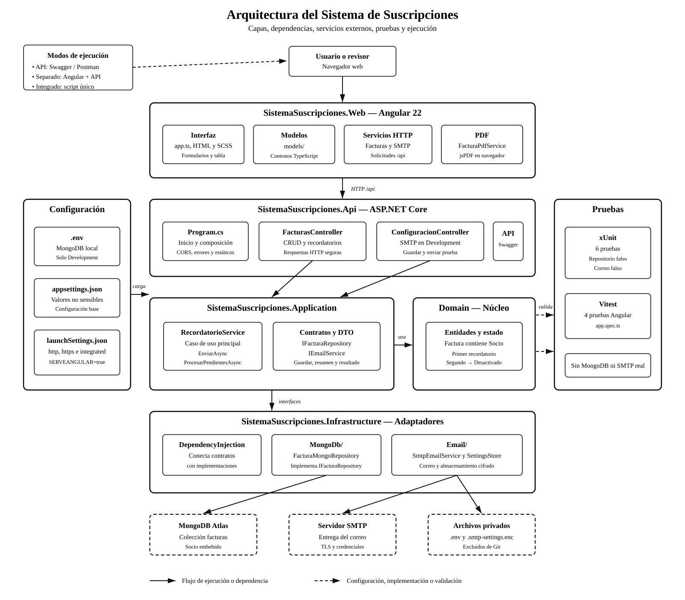
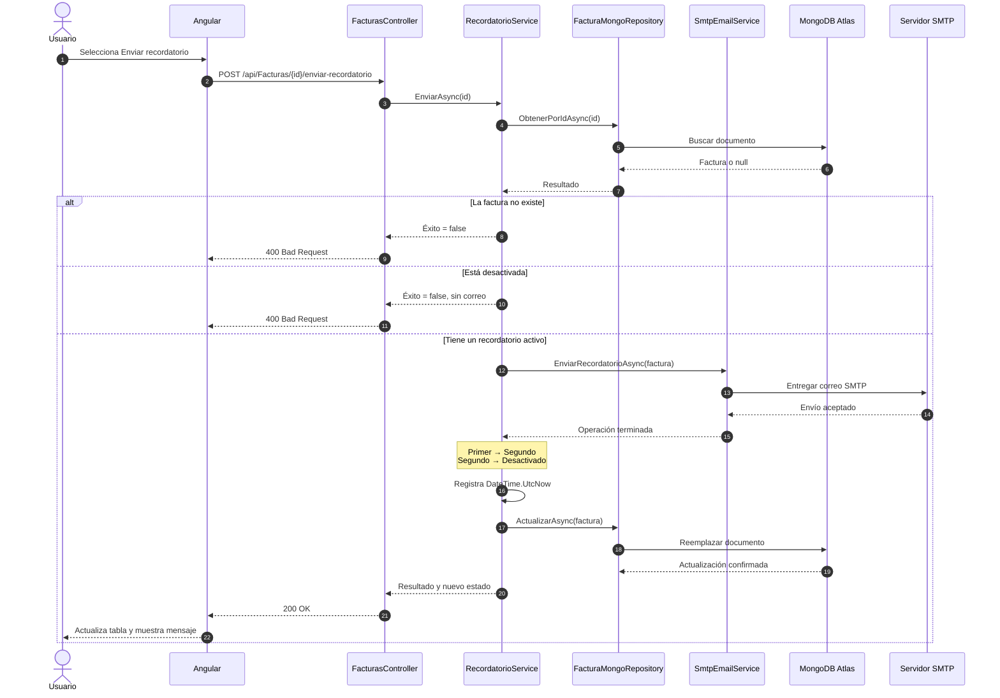
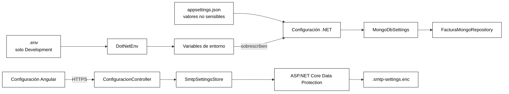

# Diagrama general del Sistema de Suscripciones

Este documento presenta visualmente la organización del código, las dependencias entre capas, los servicios externos, las pruebas y las formas de ejecución. GitHub renderiza los bloques Mermaid automáticamente.

Versiones exportables: [SVG](diagrama-arquitectura.svg) · [PNG](diagrama-arquitectura.png)

## Arquitectura completa

```mermaid
flowchart TB
    Usuario([Usuario])
    Revisor([Revisor técnico])

    subgraph Ejecucion[Modos de ejecución]
        Separado[Modo separado<br/>Angular :4200 + API :7275]
        Integrado[Modo integrado<br/>ejecutar-integrado.sh]
        ApiSolo[API únicamente<br/>Swagger o Postman]
    end

    subgraph Web[SistemaSuscripciones.Web — Angular 22]
        Vista[app.html y app.scss<br/>Interfaz y formularios]
        Componente[app.ts<br/>Estado y comportamiento]
        FacturasWeb[FacturasService<br/>CRUD y recordatorios]
        SmtpWeb[ConfiguracionSmtpService<br/>Configuración de correo]
        PdfWeb[FacturaPdfService<br/>Generación con jsPDF]
        ModelosWeb[models/<br/>Contratos TypeScript]

        Vista --> Componente
        Componente --> FacturasWeb
        Componente --> SmtpWeb
        Componente --> PdfWeb
        FacturasWeb -. utiliza .-> ModelosWeb
        SmtpWeb -. utiliza .-> ModelosWeb
    end

    subgraph Api[SistemaSuscripciones.Api — ASP.NET Core]
        Program[Program.cs<br/>Inicio y composición]
        FacturasController[FacturasController<br/>CRUD y recordatorios]
        ConfigController[ConfiguracionController<br/>SMTP local]
        Swagger[Swagger / OpenAPI]
        ErrorHandler[Manejo seguro de errores]

        Program --> FacturasController
        Program --> ConfigController
        Program --> Swagger
        Program --> ErrorHandler
    end

    subgraph Application[SistemaSuscripciones.Application — Casos de uso]
        Recordatorio[RecordatorioService<br/>Regla de transición]
        RepoInterface[IFacturaRepository]
        EmailInterface[IEmailService]
        RecordatorioInterface[IRecordatorioService]
        Dtos[DTOs<br/>Guardar, resumen y resultado]

        RecordatorioInterface --> Recordatorio
        Recordatorio --> RepoInterface
        Recordatorio --> EmailInterface
        Recordatorio --> Dtos
    end

    subgraph Domain[SistemaSuscripciones.Domain — Núcleo]
        Factura[Factura]
        Socio[Socio]
        Estado[EstadoRecordatorio<br/>Primer → Segundo → Desactivado]

        Factura --> Socio
        Factura --> Estado
    end

    subgraph Infrastructure[SistemaSuscripciones.Infrastructure — Adaptadores]
        DI[DependencyInjection<br/>Une interfaces e implementaciones]
        MongoRepo[FacturaMongoRepository]
        MongoSettings[MongoDbSettings]
        SmtpService[SmtpEmailService]
        SmtpSettings[SmtpSettings]
        SmtpStore[SmtpSettingsStore<br/>Cifrado Data Protection]

        DI --> MongoRepo
        DI --> SmtpService
        DI --> SmtpStore
        MongoRepo --> MongoSettings
        SmtpService --> SmtpStore
        SmtpStore --> SmtpSettings
    end

    subgraph Externos[Servicios y almacenamiento externos]
        Mongo[(MongoDB Atlas<br/>colección facturas)]
        ServidorCorreo[[Servidor SMTP]]
        ArchivoEnv[.env local<br/>Conexión MongoDB]
        ArchivoSmtp[.smtp-settings.enc<br/>Configuración cifrada]
    end

    subgraph Pruebas[Pruebas automatizadas]
        Xunit[xUnit<br/>RecordatorioServiceTests.cs]
        Fakes[Repositorio y correo falsos]
        Vitest[Vitest<br/>app.spec.ts]

        Xunit --> Fakes
        Fakes --> Recordatorio
        Vitest --> Componente
    end

    Usuario --> Vista
    Revisor --> Ejecucion
    Separado --> Web
    Separado --> Api
    Integrado --> Program
    ApiSolo --> Swagger

    FacturasWeb -->|HTTP /api/Facturas| FacturasController
    SmtpWeb -->|HTTP /api/configuracion/smtp| ConfigController
    PdfWeb -->|Descarga local| Usuario

    FacturasController --> Dtos
    FacturasController --> RepoInterface
    FacturasController --> RecordatorioInterface
    ConfigController --> SmtpStore
    ConfigController --> EmailInterface

    Application --> Domain
    MongoRepo -. implementa .-> RepoInterface
    SmtpService -. implementa .-> EmailInterface
    Program --> DI

    MongoRepo --> Mongo
    SmtpService --> ServidorCorreo
    ArchivoEnv --> MongoSettings
    SmtpStore --> ArchivoSmtp

    classDef actor fill:#ffffff,stroke:#000000,color:#000000,stroke-width:2px;
    classDef component fill:#ffffff,stroke:#000000,color:#000000;
    class Usuario,Revisor actor;
    class Separado,Integrado,ApiSolo,Vista,Componente,FacturasWeb,SmtpWeb,PdfWeb,ModelosWeb,Program,FacturasController,ConfigController,Swagger,ErrorHandler,Recordatorio,RepoInterface,EmailInterface,RecordatorioInterface,Dtos,Factura,Socio,Estado,DI,MongoRepo,MongoSettings,SmtpService,SmtpSettings,SmtpStore,Mongo,ServidorCorreo,ArchivoEnv,ArchivoSmtp,Xunit,Fakes,Vitest component;
```

## Flujo de un recordatorio

## Flujo de configuración

## Interpretación

1. Angular únicamente presenta información y consume la API; nunca se conecta directamente con MongoDB o SMTP.
2. Los controladores traducen HTTP a operaciones de aplicación, pero la transición de recordatorios pertenece a `RecordatorioService`.
3. Application depende de Domain y utiliza interfaces para evitar dependencias directas con tecnologías externas.
4. Infrastructure implementa las interfaces utilizando MongoDB y SMTP.
5. `DependencyInjection` conecta cada interfaz con su implementación durante el inicio de la API.
6. Las pruebas de `RecordatorioService` usan objetos falsos, por lo que no requieren base de datos ni correo real.
7. El modo separado favorece el desarrollo; el integrado facilita la demostración con un único servidor.
8. Los secretos permanecen fuera del código y de Git.

